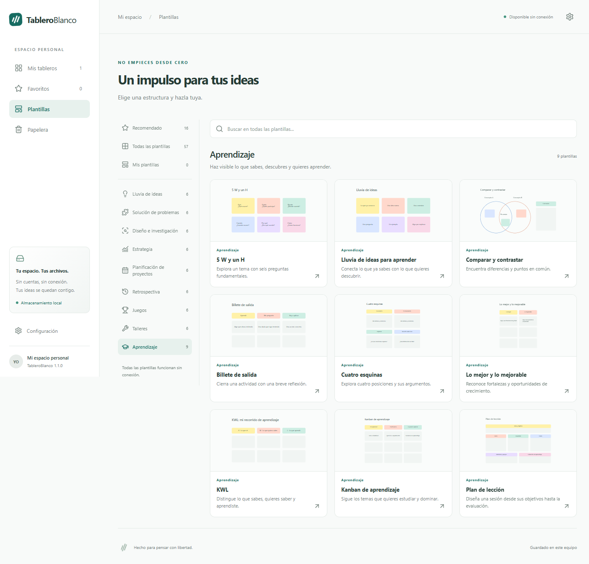
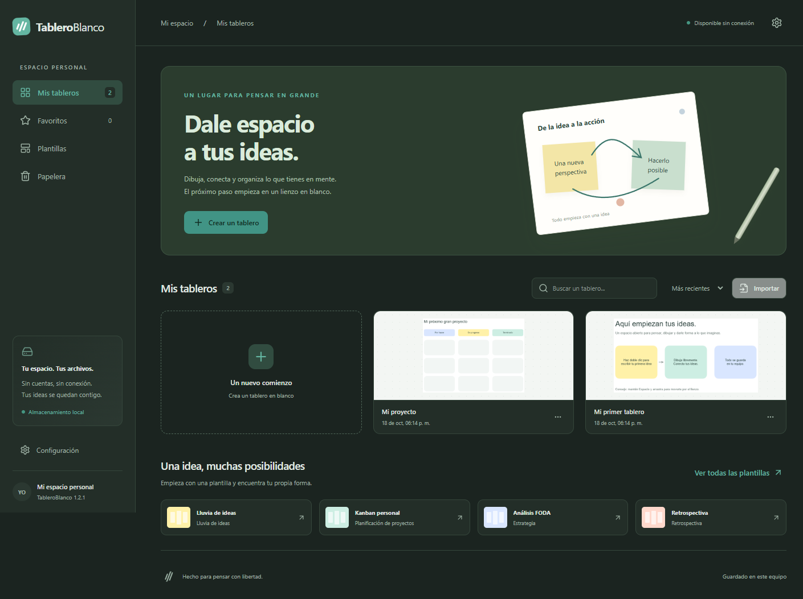

# Capturas de TableroBlanco

Estas imágenes muestran la aplicación con datos de demostración. No contienen tableros personales. Las capturas de inicio, editor y tema oscuro corresponden a la versión 1.2.1.

## Pantalla principal

Biblioteca local, creación de tableros, favoritos, papelera y accesos a plantillas.

## Editor

Texto, notas adhesivas y herramientas de dibujo en un lienzo desplazable.

## Plantillas por categoría

El catálogo contiene 57 plantillas editables en nueve categorías. Permite buscar en toda la biblioteca y reutilizar plantillas personales.

## Tema oscuro

La apariencia se cambia desde Configuración y se conserva en el equipo.

## Idiomas

Español, inglés y chino simplificado. El cambio de idioma afecta a la interfaz y a las plantillas nuevas; conserva el contenido escrito por el usuario.

[Volver al inicio del repositorio](../README.md) · [Descargar la aplicación](https://github.com/edwincsabo/TableroBlanco/releases)
