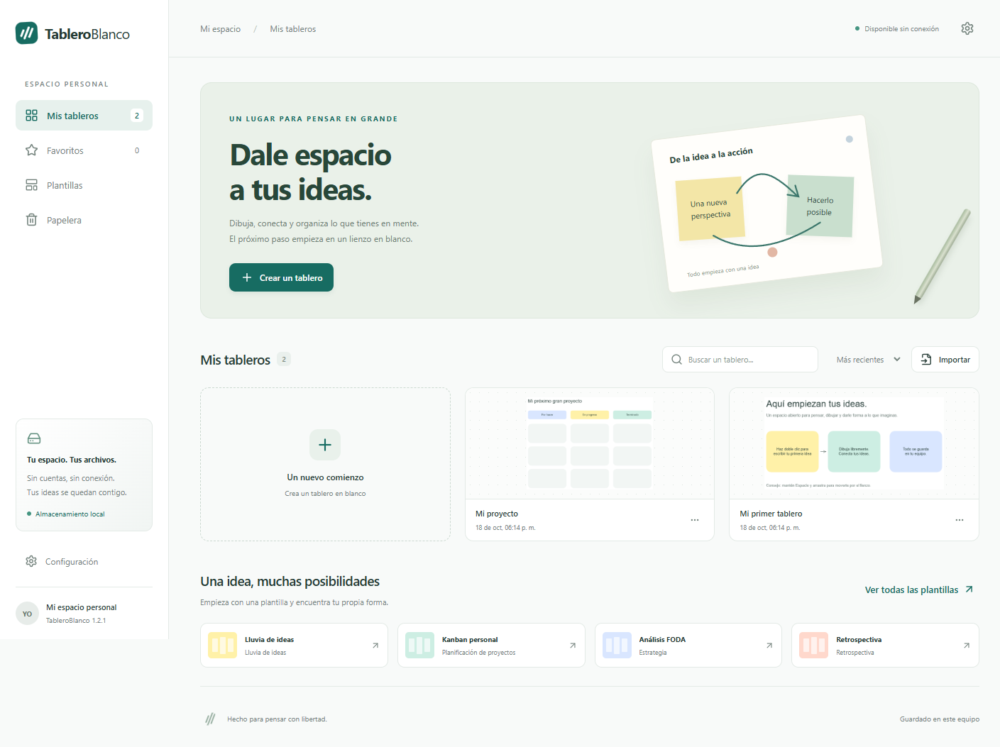
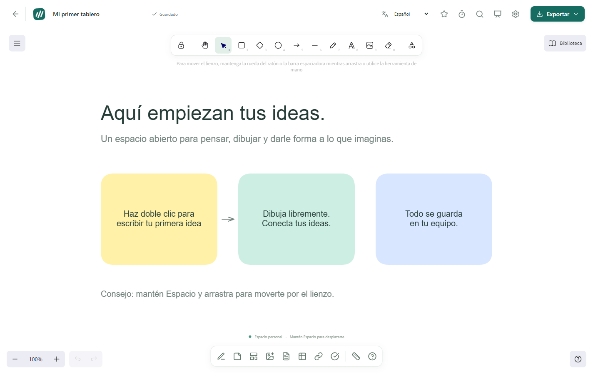
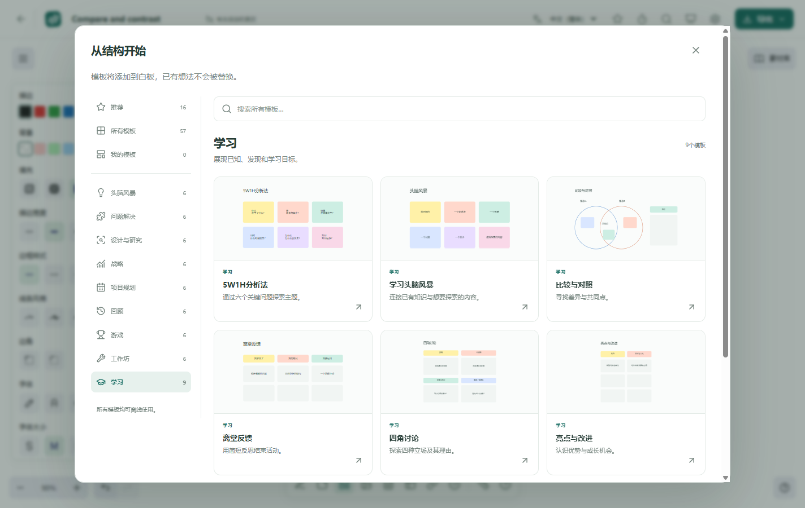

# TableroBlanco

[Español](../README.md) · **English** · [简体中文](README.zh-CN.md)

A personal whiteboard for Windows x64. Draw, organize ideas, use templates and annotate documents without creating an account or relying on a cloud service.

The app is available in Spanish, English and Simplified Chinese.

[Download for Windows](https://github.com/edwincsabo/TableroBlanco/releases) · [User guide (Spanish)](GUIA.md) · [Screenshots](SCREENSHOTS.en.md) · [License](../LICENSE) · [Contributing (Spanish)](../CONTRIBUTING.md)



## Download and install

1. Open [Releases](https://github.com/edwincsabo/TableroBlanco/releases).
2. Expand **Assets** for the version you want to use.
3. Download `TableroBlanco-1.2.1-Instalador.exe`, or the installer for that version. `Instalador` means installer; the filename is the same for every app language.
4. Close any running instance of TableroBlanco and run the installer. You can choose the installation folder and create shortcuts.

To use the app without installing it, download `TableroBlanco-1.2.1-Portable.exe`. Boards are saved in your Windows user profile, including when using the portable version. You do not need Node.js, npm or Electron to use these executables.

The initial release is a prerelease, and the executables do not have a commercial digital signature. In the local development environment, Device Guard blocked an earlier build; protections were not disabled to test it. See [verification details (Spanish)](../VERIFICACION.md) and the notes for each release. If your organization blocks execution, ask your administrator to review the app.

## Features

- A canvas with panning, zoom, multiple selection, grouping and object stacking.
- Pencil, marker, highlighter, eraser, laser pointer, ruler, shapes, lines, arrows and text.
- Sticky notes, note grids, card-style comments, editable tables and lists.
- PNG, JPEG, WebP, GIF and SVG images; import PDF pages as images to annotate them.
- 57 templates in nine categories, global template search, recommendations and personal templates.
- Timer, text search, presentation mode, backgrounds, light and dark themes.
- Autosave, version history, favorites, duplication and trash.
- Full backups and import of `.tablero` and `.excalidraw` files.
- Export to editable `.tablero`, PNG, SVG and PDF.
- Spanish, English and Simplified Chinese interface, with a saved language preference.

## The editor

A canvas for writing, drawing and connecting ideas. Drawing tools are in the top toolbar; the bottom toolbar lets you insert notes, images, documents, templates and other elements.



See the templates, dark theme and Chinese interface in the [screenshot gallery](SCREENSHOTS.en.md). Screenshots show the app in Spanish or Simplified Chinese; captions are in English.

## Templates

| Category | Count |
| --- | ---: |
| Brainstorming | 6 |
| Problem solving | 6 |
| Design and research | 6 |
| Strategy | 6 |
| Project planning | 6 |
| Retrospectives | 6 |
| Games | 6 |
| Workshops | 6 |
| Learning | 9 |

Includes mind maps, Kanban, SWOT, SCAMPER, five whys, empathy maps, business models, roadmaps, retrospectives, KWL, concept comparisons and lesson plans. Create a board from a template or insert one into an existing board without replacing its content.

## Languages

Choose **Settings → Application language**, or use the language selector in the editor. The change takes effect without closing the board and is remembered when you restart the app.

The interface and new templates are translated. Text in your notes, existing board names and personal templates stays in the language in which you wrote it.



## Saving and backups

Boards are saved automatically on your computer. Open their exact location through **Settings → Open boards folder**; it is usually `%APPDATA%\tableroblanco\tableros`.

In Settings, you can create a full JSON backup and restore it on another computer. Restoring creates copies and keeps existing boards. Full backups do not include version-history snapshots.

Keep a backup before updating or moving your profile. The app does not sync files between devices.

## Scope

TableroBlanco is an independent app with no affiliation with Microsoft. It is designed for personal, local use. It does not reproduce every Microsoft Whiteboard feature.

It does not include accounts, real-time collaboration, OneDrive, Teams, Loop, Copilot or import of the proprietary `.whiteboard` format. PDF pages are inserted as images; tables and lists are canvas compositions. Ink recognition is limited to closed circles and rectangles. GIFs are used as static images.

## Source code and development

Requirements: Windows x64, Node.js 24 and npm.

```powershell
git clone https://github.com/edwincsabo/TableroBlanco.git
cd TableroBlanco
npm ci
npm run build
npm run desktop
```

To work on the interface, run `npm run dev`. In another terminal, start Electron with:

```powershell
$env:TABLERO_DEV = '1'
npm run desktop
```

Tests:

```powershell
npm test
npm run build
npm run test:ui
```

To build the installer and portable executable:

```powershell
npm run dist
```

Output files are written to `version-final/<version>/`. If Electron was not downloaded during `npm ci`, run `node node_modules/electron/install.js` before packaging.

## License and commercial use

The project's own code is distributed under the **TableroBlanco No-Sale License 1.0**:

- You may use and modify it, including within businesses.
- You may share copies free of charge.
- You may charge for support, customization, training, consulting or hosting services.
- You may not sell the program, software licenses for it or modified versions containing its code.

Read [LICENSE](../LICENSE) and the [plain-language explanation](LICENSE.en.md). The English text of `LICENSE` is authoritative and takes precedence over translated summaries. This is a project-specific source-available license with a no-sale restriction, not an OSI-approved open-source license. It does not replace permissions granted for earlier versions or third-party licenses.

## Acknowledgments and components

The canvas uses [Excalidraw](https://github.com/excalidraw/excalidraw). The app is built with React, TypeScript, Vite, Electron, PDF.js, jsPDF and Lucide. See [THIRD_PARTY_NOTICES.md](../THIRD_PARTY_NOTICES.md) and [licenses/](../licenses/).

## Reporting issues and contributing

Use [Issues](https://github.com/edwincsabo/TableroBlanco/issues) to report bugs or suggest improvements. Include the version, steps to reproduce and expected result; do not publish private information or personal boards.

The [contribution guide](../CONTRIBUTING.md), [security policy](../SECURITY.md), [user guide](GUIA.md) and [release publishing guide](PUBLICAR.md) are currently in Spanish. This README covers installation and the main usage instructions in English.
